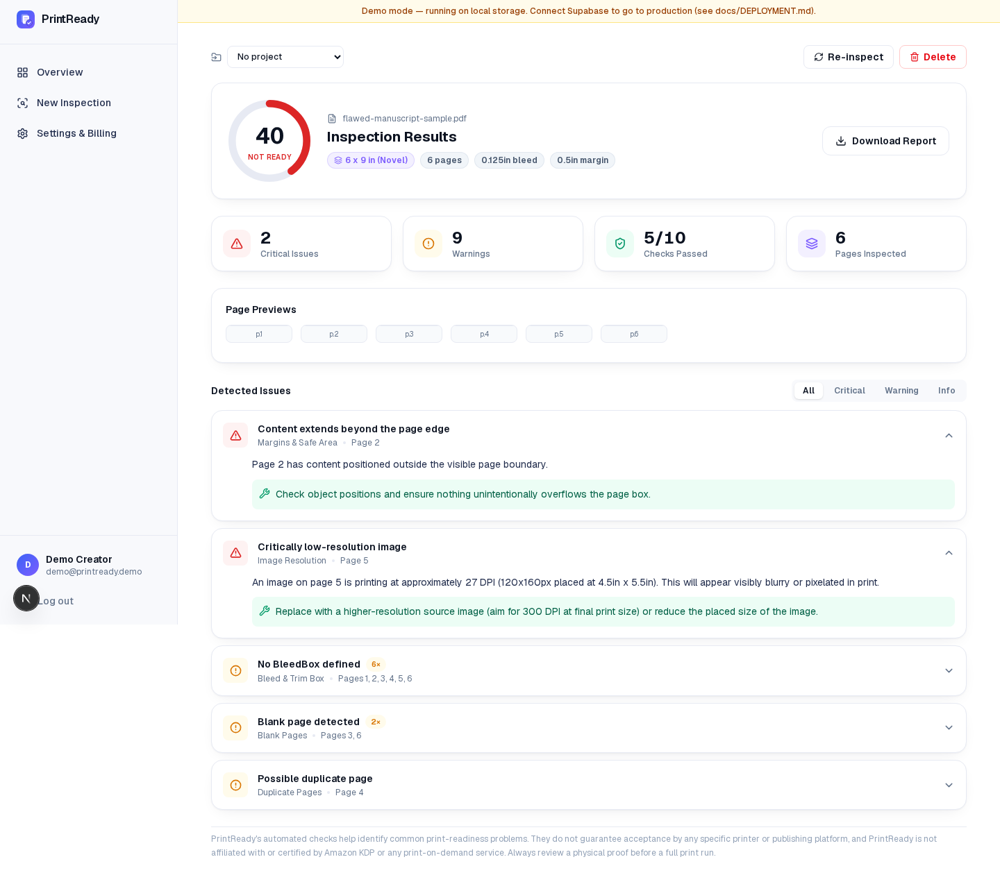

# PrintReady

**Catch costly printing mistakes before you publish.**

PrintReady is an automated PDF preflight and quality-assurance platform for
self-publishers and print-on-demand creators. Upload a PDF, choose your
print specification, and get a color-coded inspection report covering page
dimensions, image resolution, bleed/margins, font embedding, blank/duplicate
pages, structural integrity, and color-space warnings — with a page number,
plain-English explanation, and recommended fix for every issue found.

This is a complete, working product: real PDF analysis (no fabricated
results), real accounts, real project history, real downloadable reports.



More real, unedited screenshots of the running app — landing page, login,
project dashboard, new-inspection flow, admin dashboard, mobile view — are in
[`docs/screenshots/`](docs/screenshots/). A full pass/fail QA matrix (upload
validation, scoring accuracy, plan-limit enforcement, cross-user isolation,
error handling on corrupted/invalid files) is documented in
[`docs/QA_REPORT.md`](docs/QA_REPORT.md).

## Quick start (local development / demo mode)

PrintReady runs with **zero configuration** out of the box using a built-in
local SQLite database — no Supabase project required to try it.

### 1. Start the PDF processing service

```bash
cd pdf-service
python3 -m venv .venv && source .venv/bin/activate
pip install -r requirements.txt
python make_samples.py          # generates sample PDFs used by the demo/QA
uvicorn main:app --host 0.0.0.0 --port 8000
```

### 2. Start the Next.js app

```bash
npm install
cp .env.example .env.local      # defaults already work for local/demo mode
npm run dev
```

Visit **http://localhost:3000**.

### Demo accounts (local/demo mode only)

| Role | Email | Password |
|---|---|---|
| Admin | `admin@printready.demo` | `PrintReadyAdmin!2026` |
| Creator | `demo@printready.demo` | `PrintReadyDemo!2026` |

These are seeded automatically the first time the local database is created
(`src/lib/db/local.ts`). They do not exist when running against production
Supabase — see `docs/DEPLOYMENT.md`.

## Going to production

Set three environment variables (`NEXT_PUBLIC_SUPABASE_URL`,
`NEXT_PUBLIC_SUPABASE_ANON_KEY`, `SUPABASE_SERVICE_ROLE_KEY`) and PrintReady
automatically switches from the local SQLite adapter to production Supabase
(Postgres + Auth) — no code changes required. Full instructions:
**[`docs/DEPLOYMENT.md`](docs/DEPLOYMENT.md)**.

## Documentation

| Doc | Contents |
|---|---|
| [`docs/ARCHITECTURE.md`](docs/ARCHITECTURE.md) | How the system is built, the 10 quality checks, security model |
| [`docs/DEPLOYMENT.md`](docs/DEPLOYMENT.md) | Step-by-step production deployment + hosting cost estimates |
| [`docs/BILLING_SETUP.md`](docs/BILLING_SETUP.md) | Enabling real Freemius payments |
| [`docs/ADMIN_GUIDE.md`](docs/ADMIN_GUIDE.md) | Using the admin dashboard |
| [`docs/BUSINESS_OVERVIEW.md`](docs/BUSINESS_OVERVIEW.md) | Product positioning, pricing rationale, honest limitations |
| [`docs/ROADMAP.md`](docs/ROADMAP.md) | Suggested future development |
| [`docs/THIRD_PARTY_DEPENDENCIES.md`](docs/THIRD_PARTY_DEPENDENCIES.md) | Full dependency + licensing list |
| [`docs/TRANSFER_CHECKLIST.md`](docs/TRANSFER_CHECKLIST.md) | Ownership transfer steps |
| [`.env.example`](.env.example) | Every environment variable, documented |

## Tech stack

Next.js (App Router) · TypeScript · Tailwind CSS v4 · Supabase (Postgres +
Auth), with a zero-config local SQLite fallback · Python/FastAPI PDF
processing service using PyMuPDF, pypdf, Pillow, and ReportLab.

## Project structure

```
printready/
├── src/
│   ├── app/              # Next.js routes (marketing site, auth, dashboard, API)
│   ├── components/       # UI components (landing, dashboard, auth, ui primitives)
│   └── lib/               # Data adapters, auth session, plans, validation, PDF client
├── pdf-service/           # Python FastAPI PDF analysis microservice
│   ├── analysis/          # engine.py (10 checks), report.py (PDF report), specs.py
│   └── make_samples.py    # generates the bundled sample/QA PDFs
├── supabase/migrations/   # Production Postgres schema + RLS policies
├── storage/                # Shared uploads/thumbnails/reports/samples directory
└── docs/                   # Full documentation + acquisition package
```

## License / ownership

This repository and all code within it is a standalone product intended for
sale/transfer. See `docs/TRANSFER_CHECKLIST.md`.
